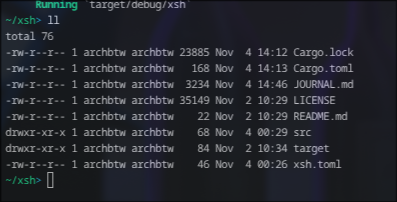
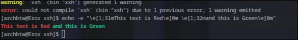
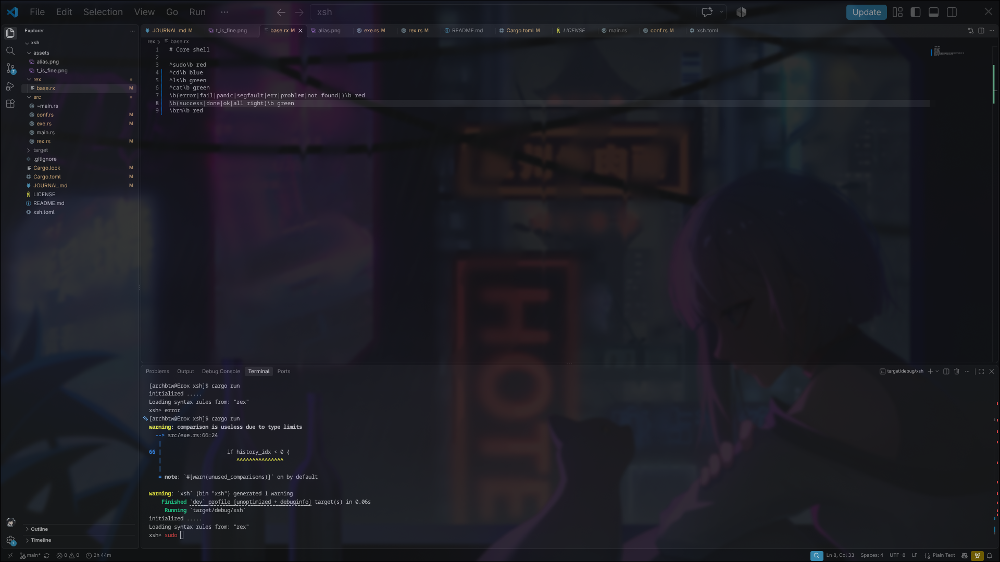
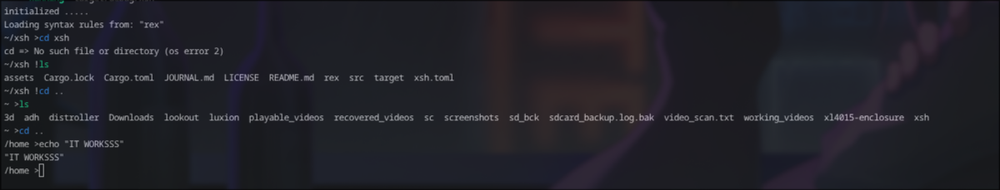
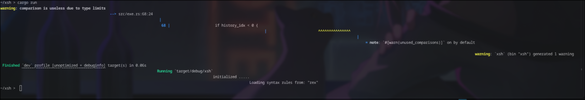

# Starting 

Today i am goin to write a custom shell in rust , becaause bash is way too old and zsh doesnt have wht i want .
i think imma gonna use stdin for now and write a real real basic version .

i was js trying to write a real basic verion but vs code said , nah i am gonna help u with an odd version lol , anyways 

done with the v0.00001 , it works , basic ls , cd and pwd works it runs really fast though , but it doesnt have new line after excuting , i am not going to fix tht at all , 

i will commit and move to v1

# v0.0.2

we will use reedline now instead of my prev stdin approach because i wd like to use the arrows tooo

okkk done , afteri forgot the wildcard _=> , and wasted time , now we have an working sheel tht can execute all basic command , oh lets try pacman if reedline supports tht,

holyy IT Supports pacman too , and it probably has history because of reedline , using external crates doesnt feel fair but why not?

ok now for v0.0.3 i think i will add pipes and then i will add something tht absolutely differtiates it with bash and zsh , wait i didnt try nvim , lemme try it

NVIM WORKSS TOO , reedline absolutely cooked this time .

ok i got it a lil messed up , but fixed it and now the legenedary irony , push frm my shell!!!

ok it basically gave a pathspec prob but thts for later not now 

# Regex colour highlightin and aliases, v0.0.3

ok so we gonna make a new file named rex.rs and a lot more , we will do a whole new file extension named ".rx" (short frm for regex) 


ok clearly separated the terminal execution workflow , now we gonna do something like a regex like design of my .rx extension , like 

```rx
# pattern   styles
^git\s+push green
```

looks fine , right? anyways lets write the parser first

 i wrote a lot of code and then i realized i can make it far faster and smaaller like i used a struct named rule , i dont even need it for now , i dont knwo why the hell did i even write it , and the rust auto syntax is way too annoying , i mean its good, but wht if i get flaged as ai?

 also i am seeing this a lot , the rust syntax highlighter always rewrites , my regex as a pattern data type BRUH BOTH ARE DIFF , who's gonna tell it to a syntax highlighter?

 bruh this highlighter is a rule based one but its guessing wht i am gonna write(because i have fns and impls thts how he know) but it looks lowk pretty advanced

 ok done , also made a xsh.toml , it will push aliases to my rex and new .rx 

 ok did all and made first alias but lol alot and tons of err , i cant js fix it , still gonna try until i cant ,

 bruh seriously , i js fixed a tuple syntax and got frm 12 errs to 21 :skull: 

 OHHH fixed all with a lil of way too much suffering , now i js needa solve the 2 errs in conf.rs and done i will go to sleep 

 ok so i fixed them all errs , js to not get the feature i built :sadage: , it js igonores my aliases i put on xsh.toml , i put a good enough logic , wait i think i see wht happended lemme try again
 yeah i got it head on 
 I PUT COMMAND INSTEAD OF FINal COMMAND , in Command::new() so i was myself the reason of my own suffering :sob:

 ok done it works 
 

 imma gonna test the highlight regex later because i am so sleepy 

---

ok i am back , lets add a regex pattern and test it, btw its pretty easy to text xsh inside xsh and write xsh inside xsh lol!

ok i added an base.rx but it doesnt work :sob: back to debugging

Oh wow i forgot to add the highlighter in my run shell fn and was wondering why main doesnt prints my debug msgs :sob:

still doesnt work :sadage: , even after adding it in exe.rx

ok it works , but no highligh lemme check again

OK now i finally found the err with a really odd bug , my terminal doesnt render normal ansi frm ni-ansi because idk but thts probably the reason , so i will do fixed 256 bit colour approach
idk not even rgb s working , WTF

ok so i read the docs , did all tht i was supposed to do but still got the classic problem , depiciency version mismatch :cryy:

wait lemme check if my terminal supports it or not 



nah my terminal is fine :lol:

ok enough of this shit now next is a diff one imma gonna get this nu-ansi out , okk verified , we wd use crossterm !

i am goin to sleep I CANT HANDLE 20 ERRS NOW
---

ahhh i tried again and  used an impl and struct to use stylize frm crossterm as style but :sob: i got 24 errs instead SO , i will rewrite in crossterm no more tht shit of nu-ansi

ok so i js tried to use reedline::style::Style after getting strucked by it 3 times , maybe ai will take our jobs :sob:

 ok enough of this shit we will drop reedline i am done with it , so the 0.0.3 will be left unfinished and we will do whole rewrite with crossterm only , though i was familiar with reedline, i dont wanna use it :hmpf:\\

 # Droping reedline , Crossterm only v0.0.4

 ok rewrote the rex.rs with a mcuh simpler logic , i sorted the text via positions, last time i was really messing it up
also i didnt even touch thte first part , the syntax highlighter impl , because if it works , it works dont touch it

wait wait wait , it means now i needa write all the execution logic myself in exe :sobbb:

ok i will be using events frm crossterm for it


okk commented the extra reedline in and wrote the exit sequence for shell in pure rust and crossterm no half cooked crates used , i js matched CONTROL + c/d if matched , std::process:exit(0) , it means kill the terminal process and if something else then {} , nothing , easy right?

okk done , wrote the up down , right left , enter backspace adn wildcard results done now i can finally write executiion process not js the side dishes nut lemme push it first 

okk so we added the old execution logic back because whatever warper , the logic is same but this time i wrote the wraper :yay:

no 16 errs ;sob: lemme fix 

ok abt the format_line() , IT WAS OUT FRM THE IMPL FRM THE START , AND THTS THE MAIN PROB

ok ik now , I GOT THE PATANTHESES WRONG lol 

i wanna use deepseek so bad ,and fix it but as it is a comeback , icant :sadge:


IT WORKSSSS YAYYYYYYYYYYYYYYYYYYYYYYYYYYYYYYYyy

the colour and alias both works and i didnt even use reedline , all of this with js std and crossterm hell yeah 



---

droping reedline was the best thing i could have done , brilliant move (!!)

# v0.0.5 new feature custom prompt showing dir 

the current xsh> looks so dull so i am thinking to do something lik `$(pwd) xsh >` and its really easy , most imperfect decision for 0.0.5 which sounds like a major version lol

ok i will fo with something like prmpt.rs and add the dir fn there and use tht on exe done 

ok i wrote the whole and did some debugging but when testing , i saw it working really odd , its trying to render ! but showing " " or js space and the dir function isnt workin too m gotta fix it tomorrow

oh so i was working with dir? journaling helps a lottt

ok a fresh mind is really essential thing , i js sat right now less than 5 mins and fixed it , i js put the fetch function inside inner loop and was didnt even called it lol 



ok changed the prompt initial text with a extra space also , added a ">" after the err sign "!" it looks like a macro to me lol 

---

# v0.0.6 adding shelex to make git commit work

in the current version , i cant commit frm xsh because ti `.whitespace()` the prompt frm user so when i type , git commit -m"i use arch btw ", whitespace breaks the quotes too and passes "i , use , arch , btw" to git and it throws an err , so only it works for one word which sucls , i will fix it real quick with shlex and also i will add wilcard(glob) on next version , v0.1 will be the first release ,!!

IT WORKSSSSS easy .

---

# v0.0.7 adding glob to use wildcards like "*" "?"

ok i js added glob and it was pretty easy , didnt took much time at all , i js added glob , rewrote the arg pushing portion and done anyways i did it so see ya in next commit UwU

wait also i found too many \n in the output i needa fix tht 

---

# v0.0.7 bug fix

i saw the err is like this 

 also wildcard doesnt work with allias so imma gonna fix those two


okk i saw the err , its i used whitespace() for the alias side , legacy code v/s dev lol 
okk so the shlex didnt fix it , i think i will add it to TODO list lol , and now i needa fix the oddly behaviour of a lot of \n

mizuketa , i used crossterms  cleartype unitnewline which generates a new line on each , tht the source of all errs , i got it , easy fix

ok now i used move to coloumn 0 so it takes me to the first portion and i will reprint the prompt but wll it fix it? time knows the ans, 

so it didnt work , idk why lets try the docs or source code

ohh i realized a thing lemme verify it first

yeaha hell yeah i am a genious , i saw it and found it , the stylize in crossterm generates a ansi-escape which makes the terminal see more than what chars i have got , easy i will needa strip tht 
i js realized i am pretty good in debugging even without ai.

ok looks like i am not , i added strip frm `strip_ansi_escapes` but the odd expansion still is here :skull: lol  

ok i think i have to do the neuclear method , track coloumn and row both 

I LITERALLY TRIED FUCKING EVERYTHING IT DOESNT WORKS AT ALL

OK i found it ,  i think this one will be a save , if it is not , i will put it to rodo list , I have been passing a string with both colour and text as a single string , how abt if i js push both as a vec and remove the colour frm printing instead of usinf the strip_ansi crate? i think this one will definately work , if it doesnt , todo be ready 