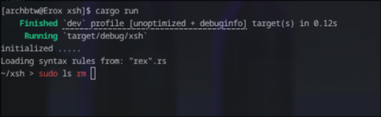
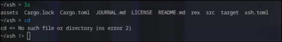

# xsh

I am an arch user , terminal is one of the most important things in my workflow , so i thought why not make one myself?

Thts how xsh was born , i have got quite good in rust and rust is memory safe and better than allll other languages so i used rust , even my punch line and moto in this proj is =>

 > `Custom shell but in rust`

 #  FEATURES

- Interactive shell made with crossterm
- custom syntax highlighting with regex patterns 
- Exit status indicator (is something goes wrong , it changes frm ~> to ~!>)
- Built in cd , faster than the c fork

rest features are same as bash lol 

- Aliases
- Tab completion
- Globbing
- history 

# KEYBOARD SHORTCUTS

```md
- Enter         => Execute 
- Tab           => Complete command/path
- Up/Down       => Navigate through history 
- Right/Left    => Move cursor
- Ctrl + C/D    => Exit terminal
- Ctrl + A      => Move to start of line 
- Ctrl + E      => Move to end of line 
```

# CONFIGURATION

## Alias

Aliases are supoosed to get tuned in xsh.toml 

### example =>

```toml

[aliases]

ll = "ls -l"
la = "ls -a"
g = "git"

```

## Syntax highlighting

One needs to add a regex pattern in a file with rx extension inside the rex dir in root dir

each rule contains a regex pattern followed by a colour name : 

### Syntax =>

```
pattern<in regex> colour // one space 
```

### suppoerted colours =>

> <span style="color: red;">red</span>

> <span style="color: green;">green</span>

> <span style="color: blue;">blue</span>

> <span style="color: yellow;">yellow</span>

> <span style="color: magenta;">magneta</span>

> <span style="color: cyan;">cyan</span>


### Example 

```rx
# Core shell 

^sudo\b red
^cd\b blue
^ls\b green
^cat\b green
\b(error|fail|panic|segfault|err|problem|not found|)\b red
\b(success|done|ok|all right)\b green
\brm\b red
```
  

Here sudo got highlighted but ls didnt because ls regex here makes it highlight only when start of lines , and rm s regex supported in mid highlight too
---



here cd and ls both got highlighted and cd returned the err code , so prompt went  `~/xsh !>`

# Build and Run 

```sh
git clone https://github.com/Erox-02/xsh
cd xsh*
cargo run 
```

and for the faster optimized version ,

```sh
cargo build --release && cargo run
```

### dependencies

crossterm = "0.29.0"
glob = "0.3.4"
regex = "1.13.1"
serde = "1.0" 
shlex = "2.0.1"
toml = "1.1.8"

# Author

### Erox-02 
> I use arch btw

# license

Gpl-3.0 , for more info check `./xsh/LICENSE`